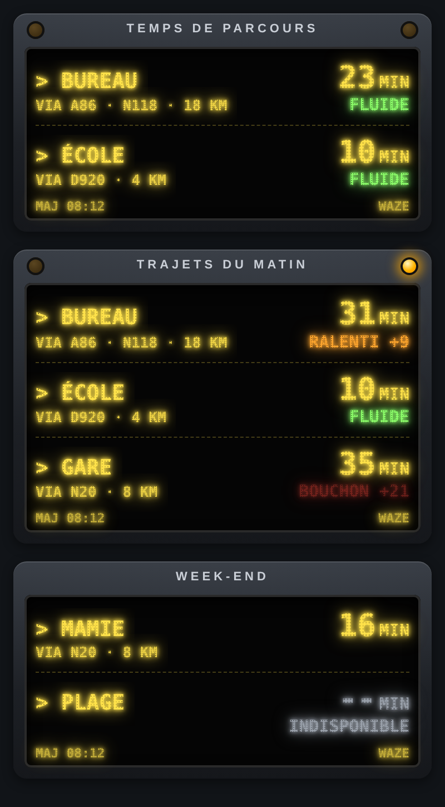
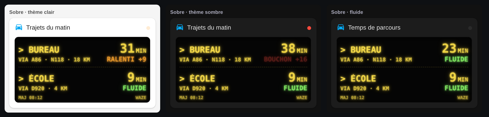
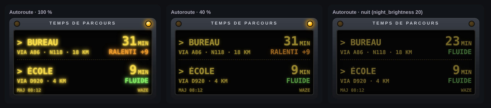
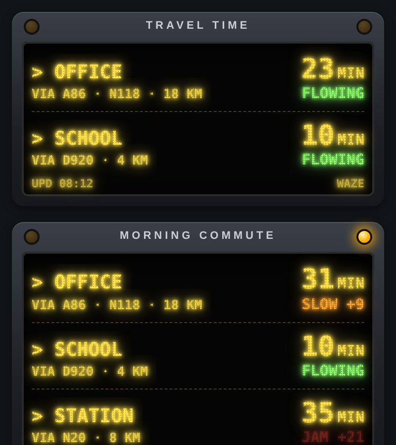

# Trajet LED Card 🚗

Carte Home Assistant façon **panneau à messages variables d'autoroute** (ou en **style sobre** qui suit votre thème) : temps de trajet en **afficheurs LED**, état du trafic (fluide, ralenti, bouchon) et **feux orange qui clignotent** quand ça bouchonne.





[](https://my.home-assistant.io/redirect/hacs_repository/?owner=Robote7701&repository=trajet-ledcard&category=plugin)

> 🇬🇧 [English version below](#-english)

---

## ✅ Ce qu'il faut avant

La carte affiche des **capteurs de temps de trajet en minutes**. Un capteur = un trajet.

1. **Un capteur de temps de trajet** par trajet :
   - **Waze Travel Time** (intégration officielle, gratuite, sans clé) — recommandé : *Paramètres → Appareils et services → Ajouter une intégration → Waze Travel Time*, puis départ et arrivée (adresse, coordonnées ou `zone.home`).
   - ou **Google Maps Travel Time** (clé API Google), ou tout autre capteur dont l'état est une durée en minutes.
2. **Facultatif mais conseillé : un « temps normal »** pour calculer le retard. Le plus simple : *Paramètres → Appareils et services → Entrées → Créer une entrée →* **Statistiques**, choisissez le capteur du trajet, caractéristique **Minimum**, âge maximum **7 jours**. Vous obtenez le meilleur temps de la semaine, qui sert de référence. Vous pouvez aussi mettre un nombre fixe de minutes.

Sans temps normal, la carte affiche le temps et la route, sans état du trafic.

## 🔌 Sur quelles entités elle se base

| Donnée lue | Utilisation dans la carte |
|---|---|
| état du capteur de trajet (minutes) | temps affiché en grand |
| attribut `route` (Waze) | ligne « VIA A86 · N118 » |
| attribut `distance` | distance en km |
| attribut `attribution` | source affichée en bas (« WAZE ») |
| `last_updated` | heure de mise à jour (« MAJ 08:12 ») |
| capteur ou nombre `normal` | calcul du retard → état du trafic |

## 🖥️ Ce que montre la carte

| Affichage | Signification |
|---|---|
| 🟢 `FLUIDE` | retard inférieur à `slow_after` (5 min par défaut) |
| 🟠 `RALENTI +X` | retard entre `slow_after` et `jam_after` |
| 🔴 `BOUCHON +X` (clignote) | retard d'au moins `jam_after` (15 min par défaut) |
| feux orange | clignotent dès qu'un trajet est ralenti, plus vite en cas de bouchon |
| `INDISPONIBLE` | le capteur ne répond pas |

**Intensité des LED** réglable (`brightness`), avec une intensité différente la nuit (`night_brightness`, quand le soleil est couché) — pratique sur une tablette murale.



Toucher un trajet ouvre l'historique de son temps. Les textes passent en anglais si Home Assistant est en anglais.

## 📦 Installation

### Avec HACS (recommandé)
Cliquez sur le bouton **Ouvrir dans HACS** ci-dessus, ou :
1. HACS → menu **⋮** → **Dépôts personnalisés**.
2. URL : `https://github.com/robote7701/trajet-ledcard`, catégorie **Dashboard** (ou *Lovelace*).
3. Cherchez **Trajet LED Card** → **Télécharger**.
4. Rechargez la page (Ctrl+Maj+R). Dans l'app : *Paramètres → Réinitialiser le cache du frontend*.

### À la main
1. Copiez `trajet-ledcard.js` dans `/config/www/`.
2. *Paramètres → Tableaux de bord → ⋮ → Ressources → Ajouter* : URL `/local/trajet-ledcard.js`, type **Module JavaScript**.
3. Rechargez la page.

## ⚙️ Configuration

### Avec l'éditeur visuel
*Modifier le tableau de bord → Ajouter une carte →* **Trajet LED Card** : nom du panneau, trajets (nom, capteur, temps normal), seuils et feux.

### En YAML

```yaml
type: custom:trajet-ledcard
title: Trajets du matin          # nom du panneau
slow_after: 5
jam_after: 15
style: autoroute               # ou sobre
brightness: 100                # intensité des LED (10 à 100 %)
night_brightness: 40           # la nuit (facultatif)
routes:
  - name: Bureau
    entity: sensor.waze_bureau
    normal: sensor.waze_bureau_normal
  - name: École
    entity: sensor.waze_ecole
    normal: 9                    # temps normal fixe, en minutes
```

| Option | Défaut | Description |
|---|---|---|
| `title` | `Temps de parcours` | nom affiché en haut du panneau |
| `routes` | — | liste des trajets (obligatoire) |
| `routes[].name` | nom du capteur | nom affiché sur le panneau |
| `routes[].entity` | — | capteur de temps de trajet (minutes) |
| `routes[].normal` | — | capteur de temps normal, ou nombre de minutes |
| `slow_after` | `5` | retard (min) à partir duquel c'est « ralenti » |
| `jam_after` | `15` | retard (min) à partir duquel c'est « bouchon » |
| `show_beacons` | `true` | afficher les feux clignotants (pastille en style sobre) |
| `style` | `autoroute` | `autoroute` (boîtier métal) ou `sobre` (suit les couleurs du thème, clair ou sombre) |
| `brightness` | `100` | intensité des LED, de 10 à 100 % |
| `night_brightness` | — | intensité quand le soleil est couché (`sun.sun`) ; vide = même que `brightness` |

## ⚠️ Limites
- Le temps vient du service choisi (Waze, Google…) ; Waze se met à jour toutes les 5 minutes environ.
- Le style LED utilise une police à chasse fixe du système ; le rendu varie un peu selon l'appareil.

## 🙏 Crédits
Carte : robote7701 — licence MIT. Données de trajet : le service de votre capteur (Waze, Google…).

---

## 🇬🇧 English

A Home Assistant card that shows travel times like a **motorway variable message sign**: **dot-matrix LED** text, traffic state (flowing, slow, jam) and **amber beacons flashing** when traffic is bad.



### Requirements
One **travel time sensor in minutes** per route — **Waze Travel Time** (built-in, free, no key) is recommended; Google Maps Travel Time or any duration sensor also works. Optionally, a **normal time** to compute the delay: create a **Statistics** helper on the route sensor, characteristic **Minimum**, max age **7 days** — or give a fixed number of minutes.

### Entities used
State of the route sensor (minutes); attributes `route`, `distance` and `attribution` when available; `normal` sensor or number for the delay. 🟢 `FLOWING` below `slow_after` · 🟠 `SLOW +X` · 🔴 `JAM +X` from `jam_after`. Tap a route to open its history. Labels follow the Home Assistant language (French or English).

### Install
HACS → **⋮** → **Custom repositories** → `https://github.com/robote7701/trajet-ledcard`, category **Dashboard** → download **Trajet LED Card**, then reload the page. Manual: copy `trajet-ledcard.js` to `/config/www/` and add `/local/trajet-ledcard.js` as a *JavaScript module* resource.

### Config
```yaml
type: custom:trajet-ledcard
title: Morning commute
slow_after: 5
jam_after: 15
show_beacons: true
style: autoroute       # or sobre (follows your theme)
brightness: 100        # LED brightness 10–100 %
night_brightness: 40   # after sunset (optional)
routes:
  - name: Office
    entity: sensor.waze_office
    normal: sensor.waze_office_normal
  - name: School
    entity: sensor.waze_school
    normal: 9
```
A visual editor is available. MIT licence.
